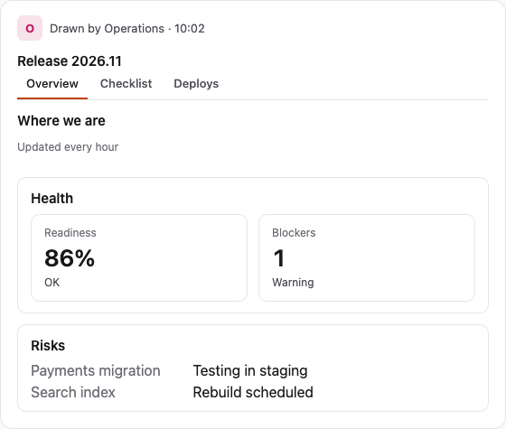

# adk-ui

Charts, metrics, pages and scenes for agent-drawn UI in [ADK-Rust](https://adk-rust.com) 3.

ADK-Rust draws agent UI with `adk-surface`'s **genui** feature: the render tools, A2UI 1.0 on
the wire (v0.9.1 for renderers that offer nothing newer), a version and digest record for every
drawing, and **rule 5**: a drawing never contains approval controls, secrets or links, and a
form's **Send** asks the person before any tool runs. genui's own `forms` catalog draws forms,
cards and tables. adk-ui 3 adds the rest as **extension catalogs** that genui checks and draws:

| Catalog | Adds to `forms` |
|---|---|
| **insight** | `Chart` (bar, line, area, pie, scatter over category, number or time axes), `VegaLite` (a Vega-Lite subset drawn as the home's chart), `Sparkline`, `Metric`, `KeyValue`, `Progress`, `Badge` |
| **studio** | insight, plus `App` (pages the host navigates), `Page`, `Region` and `Scene3D` (primitive 3D shapes with labels) |
| **spatial** | studio, plus 3D charts (`Bar3D`, `Scatter3D`, `SurfacePlot`, `Graph3D`, `Globe`), `Scene` (groups, lines, lights, motion, panels beside objects; picking an object fills a choice field the drawing shows), `DepthCard` (tilt, flip, layers) and `Stage` (stage, wall, carousel) |

adk-ui adds no render tool name, protocol, provenance record or approval path. Every component
only shows: its strings, and every string of the data it binds, are checked before anything is
drawn. The web home draws charts and 3D scenes natively, in its own palette (scenes with WebGL,
loaded only for a drawing that has one), and the rest as its own components; a host of your own
draws them richly with `@zavora-ai/adk-ui-react`. The terminal shows each one in words.

| | | |
|---|---|---|
|  |  |  |
| `Bar3D` in a `Stage` | A `Globe`, dark | A `Scene`: picking a dock fills the form, and **Reserve** asks first |
|  |  |  |
| `Metric`s and a `Chart` | An `App` of pages | A `Graph3D` beside a `DepthCard` |

All eleven sample drawings, light and dark, as the web home draws them: [docs/GALLERY.md](docs/GALLERY.md).

> adk-ui 2.x, with its own render tools and protocol adapters, stays on crates.io and npm for
> ADK-Rust 2. Moving over: [docs/MIGRATING_TO_3.md](docs/MIGRATING_TO_3.md).

## Use it

```toml
[dependencies]
adk-ui = "3"
adk-surface = { version = "3", features = ["web", "genui"] }
```

```rust
use std::sync::Arc;
use adk_surface::SurfaceEngine;
use adk_surface::genui::GenuiWiring;

// The agent draws with genui's render tools, in adk-ui's spatial catalog (all three).
let agent = HarnessAgent::builder("operations")
    .model(model)
    .toolset(Arc::new(adk_ui::toolset_for(adk_ui::catalogs::spatial())))
    .instruction(adk_ui::prompts::instructions(adk_ui::catalogs::spatial()))
    .tool(Arc::new(start_rollback))
    .build()?;

// The home shows what it draws; AG-UI clients get it too.
let engine = adk_ui::catalogs::register(SurfaceEngine::builder(Arc::new(source))).build();
let app = ServerBuilder::new(config)
    .with_ag_ui_extension(Arc::new(adk_ui::catalogs::ag_ui()))
    .add_api_routes(adk_surface::web::router(engine.clone()))
    .add_api_routes(adk_surface::web::genui::router_wired(
        engine,
        GenuiWiring { ag_ui: true, mcp_apps: false },
    ))
    .add_root_routes(adk_surface::web::home())
    .build();
```

The model draws a screen with `render_screen`:

```json
{
  "surfaceId": "incident-2041",
  "title": "Incident INC-2041",
  "components": [
    { "id": "root", "component": "Column", "children": ["p95", "latency", "start"] },
    { "id": "p95", "component": "Metric", "label": "p95 latency", "value": { "@path": "/p95" }, "unit": "ms" },
    { "id": "latency", "component": "Chart", "kind": "line", "data": { "@path": "/latency" },
      "x": { "key": "at", "type": "time" }, "series": [{ "key": "checkout", "label": "Checkout" }] },
    { "id": "start", "component": "Button", "child": "start-label", "action": { "event": { "name": "rollback" } } },
    { "id": "start-label", "component": "Text", "text": "Start rollback" }
  ],
  "dataModel": { "p95": 840, "latency": [{ "at": "2026-11-16T09:00:00Z", "checkout": 410 }] },
  "actions": [{ "id": "rollback", "label": "Start rollback", "tool": "start_rollback", "args": { "service": "checkout-api" } }]
}
```

Pressing **Start rollback** never runs `start_rollback`: the agent holds the call, and the person
decides on the home's card (Allow once, Edit or Deny).

A chart can also be written as Vega-Lite, the grammar BI tools and models already know: one
mark over the rows, with `x`, `y`, `color` (a series per value) or `theta` (a pie). Transforms,
layers, facets and data from a URL are refused by name, so the model knows what to change:

```json
{ "id": "trend", "component": "VegaLite", "data": { "@path": "/latency" },
  "spec": { "mark": "line", "encoding": {
    "x": { "field": "day", "type": "temporal" },
    "y": { "field": "ms", "type": "quantitative", "title": "p95 (ms)" },
    "color": { "field": "service", "type": "nominal" } } } }
```

Builders write the same JSON in Rust (`adk_ui::insight::{Chart, VegaLite, Metric, …}`,
`adk_ui::studio::{App, Page, …}`, `adk_ui::spatial::{Bar3D, Scene, …}`, `adk_ui::draft::Screen`),
and `Screen::validate` checks a drawing exactly as genui will.

## 3D

The spatial catalog's components only show, like every other. The server checks each scene
before it's drawn:
- colours come from the home's palette, never hex, and a state colour always has a label;
- labels are page text, checked like any string;
- there are no textures, models, fonts, shaders or links;
- everything has a cap (objects, points, labels, panels, motions).

The server also writes each scene's summary. Picking an object fills a choice field the drawing
shows (`pickInto`) and sends nothing; the drawing's own **Send** still asks first.

```rust
use adk_ui::spatial::{Motion, Object, Scene};

let yard = Scene::new("yard")
    .object(Object::new("dock-3", "box", [3.0, 0.5, 0.0]).label("Dock 3 · free").state("ok")
        .motion(Motion::pulse(2.0)).value("dock-3"))
    .pick_into("/dock")
    .build();
```

## MCP Apps

The `apps` feature adds an MCP Apps server, `adk_ui::apps::UiApps`, with two tools:

| Tool | What |
|---|---|
| `show_3d_app` | For 3D the catalog can't express: three.js the model writes, run in genui-apps' sandbox on its own origin, which can't reach the home or the network. The server refuses code that shows a decision's words, imports, fetches or talks to its parent; the page owns the render loop and a Pause button; tool calls an app asks for are held for the person |
| `show_drawing` | A drawing in adk-ui's catalogs, read-only, in any host that frames MCP Apps: checked by rule 5 and resolved on the server (`genui::drawn_tree`), drawn by a page that sets text only and reaches no site. It declares no actions, so a button is refused |

The `adk-ui-apps` binary serves both over stdio:

```bash
cargo install adk-ui --features apps   # adk-ui-apps
```

## Measuring drawings

`adk_ui::eval` scores a drawing the way genui will judge it: shown or refused (with the words the
model is told), dark-pattern warnings, the components a scenario expects, unlabelled fields,
size and depth, folded into 0 to 100 points.

```bash
cargo run --example drawing_eval                          # the sample drawings
cargo run --example drawing_eval -- --scenarios           # prompts to give a model, as JSONL
cargo run --example drawing_eval -- drawings.jsonl        # a model's drawings
```

It exits non-zero when a drawing is refused, so a prompt change can be gated in CI.

## In a host of your own

```tsx
import { DrawnView } from "@zavora-ai/adk-surface-react";
import { adkUiRenderers, KitProvider } from "@zavora-ai/adk-ui-react";

<KitProvider kit={approvedKit}>
  <DrawnView surface={surface} onSend={send} renderers={adkUiRenderers} />
</KitProvider>;
```

`recharts` is an optional peer: without it a chart is drawn as the home draws it. Vega-Lite
charts, 3D scenes, cards with depth and 3D layouts need no renderer here: `DrawnView` draws them
itself, natively, with picking into the drawing's form. See
[packages/adk-ui-react](packages/adk-ui-react/README.md) and [docs/BRAND_KITS.md](docs/BRAND_KITS.md).

## Examples

| | |
|---|---|
| [`insight_agent`](examples/insight_agent.rs) | A real agent on Claude that studies a directory with its own tools and answers with adk-ui's charts, metrics, pages and 3D. Configured from the environment (`ANTHROPIC_API_KEY`, `ANTHROPIC_MODEL`, `AGENT_WORKSPACE`, `AGENT_CATALOG`, `PORT` …, listed in the file): `ANTHROPIC_MODEL=claude-opus-5-5 AGENT_WORKSPACE=$PWD cargo run --example insight_agent`, then open `http://127.0.0.1:8807/ui/`. Add `ADK_UI_3D_APPS=1` and `--features apps` for `show_3d_app` |
| [`capabilities_tour`](examples/capabilities_tour.rs) | A guided tour of what's new, one stop a message: Vega-Lite charts, a live update, a held and sealed send, dark-pattern warnings and a refusal, `show_drawing` and `show_3d_app` framed in the home, and two MCP elicitations answered in the home's own controls. `cargo run --features apps --example capabilities_tour`, then open `http://127.0.0.1:8810/ui/`; `-- --wire` prints the A2UI 1.0 wire, a delta, Slack and Teams cards and scores |
| [`insight_home`](examples/insight_home.rs) | The ADK-Rust web home over a scripted agent that draws the eleven sample drawings: `cargo run --example insight_home -- 8806 /tmp/insight-home`, open `http://127.0.0.1:8806/ui/` and send a message |
| [`drawing_eval`](examples/drawing_eval.rs) | Scores the sample drawings, or a model's, the way genui will judge them |
| [`custom_host`](examples/custom_host) | A Vite app drawing the same drawings with `DrawnView`: the home's view, adk-ui's renderers, and two approved brand kits |
| [`fixtures/drawings`](fixtures/drawings) | The eleven sample drawings: incident command, support request, release room, store week, warehouse bays and live throughput in studio; revenue in 3D bars, a fleet on a globe, a service network, a yard to pick a dock in, and terrain in spatial |

## Versions

| adk-ui | ADK-Rust | `@zavora-ai/adk-ui-react` | `@zavora-ai/adk-surface-react` |
|---|---|---|---|
| 3.0 | 3.0 (`adk-surface` with `genui`) | 3.0 | 3.0 |
| 2.2 | 2 | 2.2 | n/a |

Rust 1.95 or later. React 18.3 or 19.

## Documentation

- [docs/ARCHITECTURE.md](docs/ARCHITECTURE.md): how adk-ui fits on genui, what each part owns,
  and how to add a component.
- [docs/MIGRATING_TO_3.md](docs/MIGRATING_TO_3.md): every 2.x tool, adapter and renderer, and
  what replaces it.
- [docs/BRAND_KITS.md](docs/BRAND_KITS.md): approved design tokens a host applies to its pages.
- [docs/GALLERY.md](docs/GALLERY.md): the eleven sample drawings as the web home draws them,
  light and dark.
- [CHANGELOG.md](CHANGELOG.md) and [RELEASING.md](RELEASING.md).
- API: [docs.rs/adk-ui](https://docs.rs/adk-ui).

## Developing

```bash
cargo test                                 # add --features apps for the MCP Apps server
cargo clippy --all-targets --all-features -- -D warnings
npm install && npm test                    # packages/adk-ui-react
```

To build against an unreleased adk-rust, copy `.cargo/config.toml.example` to
`.cargo/config.toml` (untracked) and point it at a checkout. `catalogs/` holds the catalog
documents, written from the Rust catalogs and drift-checked by `cargo test`: A2UI 1.0
documents in `catalogs/a2ui-1.0/` (only what each catalog adds, which a surface mixes with
`forms`, with its rules as `instructions`; checked against the A2UI 1.0 meta-schema) and the
v0.9.1 documents beside them. Regenerate them with
`ADK_UI_WRITE_CATALOGS=1 cargo test --test catalog_files`. The React package's registry is
checked against them.

## License

Apache-2.0. See [LICENSE](LICENSE).
