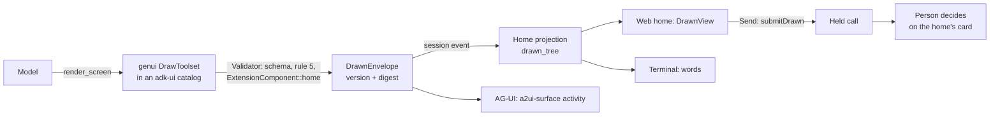

# Architecture

adk-ui 3 is a set of extension catalogs for ADK-Rust's agent-drawn UI, plus what a host needs
around them. This page says where the line between adk-ui and ADK-Rust runs, how a drawing
travels, what each part of the crate and the React package owns, and how to add a component.

## The line: genui owns the drawing, adk-ui owns components

`adk-surface`'s `genui` feature (ADK-Rust 3) is the render stack. adk-ui adds to it and never
replaces any of it.

| `genui` owns | adk-ui owns |
|---|---|
| The render tools (`render_form`, `render_card`, `render_table`, `render_screen`, `patch_surface`, `delete_surface`) and their names | Components: their schemas, their one-line usage for the model, and what the home shows for each |
| A2UI on the wire (1.0 by default, v0.9.1 for older renderers) and the stored form | Builders that write those components in Rust |
| Rule 5 (no decision's words, secrets or links, no actions but declared buttons), checked on every string and every bound value | The limits a schema can't express (rows, series, objects, panels), checked again on bound data |
| Each drawing's version and digest, provenance, and the governed send (a form's **Send** is a request the person decides) | Prompts that tell a model when and how to use the catalogs |
| The projection a renderer draws (`DrawnSurface`, `DrawnNode`) and the home's native charts, scenes and depth | Brand kits a host applies to its own pages |
| The web home, the terminal, AG-UI, MCP Apps hosting, approval cards | An MCP Apps server (`apps`), an evaluation harness (`eval`), React renderers for hosts |

So adk-ui has no tool name, protocol adapter, provenance record or approval path. If a feature
would need one, it belongs in `genui`.

## How a drawing travels

1. The agent has `genui`'s `DrawToolset` built with an adk-ui catalog
   (`adk_ui::toolset_for(catalogs::spatial())`). `render_screen` describes the catalog's
   components to the model from their `usage()` lines.
2. genui's `Validator` checks the drawing against the catalog: each extension component's
   JSON Schema, rule 5 on every string (including the data it binds), and then the
   component's `home()` projection, whose errors refuse the drawing with a reason the model
   reads.
3. genui records the drawing as a versioned, digested envelope in the session.
4. A home that registered the catalog (`catalogs::register`) projects each drawing with
   `drawn_tree`. An extension component arrives as a `DrawnNode` with its resolved properties
   (`extension`) and one child, what the home shows for it. Charts become `DrawnChart`, 3D
   becomes `DrawnScene` or `DrawnDepth`, both drawn natively by the home.
5. A form's **Send** posts `submitDrawn`. genui checks it against the stored drawing and holds
   the declared tool call for the person's decision on a card the home draws. Nothing in a
   drawing can approve anything.

## The catalogs

`src/catalogs.rs` builds three catalogs with `genui`'s `Catalog::extend`. Each is `forms` 1.0
plus its components, and each includes the one before:

| Catalog | Id | Components (`src/`) |
|---|---|---|
| insight | `https://zavora.ai/a2ui/catalogs/adk-ui-insight/1.0/catalog.json` | `insight/components.rs`, `insight/vega.rs` |
| studio | `…/adk-ui-studio/1.0/catalog.json` | insight + `studio/components.rs` |
| spatial | `…/adk-ui-spatial/1.0/catalog.json` | studio + `spatial/components.rs` |

Each catalog carries its rules (`prompts::catalog_rules`) as its A2UI 1.0 `instructions`.
`HOME_DRAWN` lists the components the home draws natively (Vega-Lite charts and everything 3D),
so hosts need no renderer of their own for them. `all()` and `register()` hand all three to a
home; `ag_ui()` gives `GenuiAgUi` the same catalogs.

**A catalog id names one schema.** A2UI gives a surface one catalog, so changing a component's
schema means a new id (`…/2.0/catalog.json`), while the old id stays registered so earlier
drawings are still checked. Adding a component to a catalog is also a schema change. The v0.9.1
and 1.0 documents of one catalog share its id: they describe the same catalog in two protocol
versions, so load one of them per schema registry.

## The extension contract

Every component implements `genui`'s `ExtensionComponent`:

| Method | What adk-ui puts there |
|---|---|
| `name()` | The component type, unique across `forms` and adk-ui |
| `schema()` | Its A2UI component schema, written with `src/schema.rs` (`component`, `text`, `data`): closed to undeclared properties, no actions, events, checks or URI formats |
| `children()` | The properties that hold other components (`App`'s pages, `Page`, `Region`, `Scene`'s panels, `DepthCard`, `Stage`), so genui checks what they hold as it checks the top level |
| `usage()` | One line for the model: what it shows and its shape, in A2UI 1.0 syntax (`{"@path": "/rows"}`) |
| `allowed_parents()`, `allowed_children()` | A2UI 1.0 composition rules, where a component only makes sense in one place (a `Page` in an `App`) |
| `home()` | What the home and the terminal show, from the resolved properties: `forms` nodes, a `HomeNode::Chart`, `HomeNode::Scene` or `HomeNode::Depth`. It is pure, and it re-checks every limit on bound data, since a schema only sees literals |

`home()` is where most of a component's logic lives. `insight/components.rs` has `chart_node`,
which turns rows and series into the home's chart (`Chart` and `VegaLite` share it); `scene.rs`
works out 3D geometry (layouts, globe positions and arcs, scales, ticks) deterministically, so
the home only draws.

## Builders

`src/build.rs` has `Props`, a component under construction, and `component_builder!`, which
gives a builder `build()` and `Into<Value>`. Each catalog's builders (`insight/build.rs`,
`studio/components.rs`, `spatial/build.rs`) write exactly the JSON a model would.
`draft::Screen` collects components, data and actions, gives `render_screen`'s arguments, and
`Screen::validate` runs the same `Validator` genui will.

## 3D

The spatial catalog projects onto `genui`'s scenes (`DrawnScene`: objects, palette colours and
labelled states, lights, cameras, motion, panels, picking) and depth effects (`DrawnDepth`). The
home draws scenes with WebGL in a lazily loaded chunk and depth with CSS 3D; the terminal shows
the server-written summary. Colours are palette tokens, never hex; labels are page text checked
by rule 5; there are no textures, models, fonts, shaders or links. Picking an object fills a
`ChoicePicker` the drawing shows, and only the drawing's **Send** sends.

## The `apps` feature

`src/apps/` is an MCP server, `UiApps`, with two tools, served over stdio by the `adk-ui-apps`
binary or in process over `tokio::io::duplex`:

- `show_3d_app` takes model-written three.js. `apps/check.rs` refuses code that shows a
  decision's words or reaches outside its frame (best effort: the boundary is the sandbox).
  The page (`three_app.html`) loads three.js from its one declared CDN and owns the render loop.
  In the home, genui-apps frames it on an origin per MCP server, with `connect-src 'none'`, and
  holds every tool call it asks for.
- `show_drawing` takes a drawing in an adk-ui catalog, checks it with genui's `Validator`,
  resolves it with `drawn_tree`, and returns the tree as structured content. Its page
  (`drawing_app.html`) sets text only, reaches no site and draws no buttons: a drawing for
  another host declares no actions, so a button is refused.

## Brand kits

`src/kit/`: `KitGenerator` turns a `KitSpec` into a draft `BrandKitManifest` (semantic tokens,
recipes for `forms` components) and CSS. A host reviews it, sets `status` to approved with
`reviewedBy` and `approvedAt`, and `ApprovedKit::try_from` accepts only an approved, valid kit.
`ApprovedKit::surface_css` sets the adk-surface tokens a host's `DrawnView` reads (card, text,
accent, focus, fonts, radius, chart colours), never a decision's or a status's. The model never
picks a kit and a drawing never carries one. See [BRAND_KITS.md](BRAND_KITS.md).

## Evaluation

`src/eval.rs` scores a drawing with genui's `Validator` and `drawn_tree`: shown or refused (with
the refusal text the model would read), warnings, expected components, unlabelled fields, size
and depth, as 0 to 100 points. `examples/drawing_eval.rs` runs it over the sample drawings or a
model's drawings and fails on a refusal.

## The React package

`packages/adk-ui-react` gives `@zavora-ai/adk-surface-react`'s `DrawnView` renderers for the
extension components the home does not draw natively (`adkUiRenderers`, keyed by catalog id).
A renderer gets the resolved, checked properties, the nodes the component holds and
`renderChild`, and never a way to send or change a value. `Chart` loads `recharts` lazily as an
optional peer, behind `OptionalRenderer`, and falls back to the home's own view. The same
components draw a host's own data outside a drawing. `KitProvider` applies approved kits only.

## Generated files and drift checks

| File | Written by | Checked by |
|---|---|---|
| `catalogs/*.json` (v0.9.1), `catalogs/a2ui-1.0/*.json`, `catalogs/index.json` | `ADK_UI_WRITE_CATALOGS=1 cargo test --test catalog_files` | `catalog_files` (drift; the 1.0 documents against the pinned A2UI 1.0 meta-schema in `tests/a2ui-1.0/`) |
| `examples/custom_host/public/surfaces.json` | `ADK_UI_WRITE_SURFACES=1 cargo test --test home_tests` | `home_tests` |
| The React registry | By hand | `packages/adk-ui-react/test/registry.test.cjs`: renderers are exactly each catalog's extensions minus `homeDrawn` |

The tests check every component the same way: `insight_tests`, `studio_tests` and
`spatial_tests` find every text property from the schemas and prove rule 5 on each (typed and
bound), so a new property is covered or the test fails; `fixture_tests` accepts every sample
drawing with no warnings; `home_tests` drives a harness agent and a home end to end.

## Adding a component

1. Implement `ExtensionComponent` in the catalog's `components.rs` (or its own file): a closed
   schema from `src/schema.rs`, a one-line `usage()` in 1.0 syntax, and a pure `home()` that
   re-checks limits on bound data.
2. Add it to the catalog's `components()` list. If the home draws it natively, add it to
   `HOME_DRAWN`.
3. Write its builder with `Props` and `component_builder!`, and export it.
4. Add a baseline instance to the catalog's tests, so rule 5 is proven on every text property,
   and test its limits and its `home()` projection.
5. Regenerate the catalog documents, and if the home does not draw it natively, add a renderer
   to `packages/adk-ui-react` (the registry test says so).
6. Mention it in the README's catalog table, the CHANGELOG and, if it replaces something from
   2.x, `MIGRATING_TO_3.md`. Adding a component changes the catalog's schema: see the
   versioning rule above.

## Versions

The crate and `@zavora-ai/adk-ui-react` share one version and are released together
([RELEASING.md](../RELEASING.md)). adk-ui 3 needs ADK-Rust 3 (`adk-surface` with `genui`) and
`@zavora-ai/adk-surface-react` 3. The 2.x line, with its own render stack, lives on
`release/2.x`.
