# What adk-ui draws

The eleven sample drawings of [`fixtures/drawings`](../fixtures/drawings), as the ADK-Rust web
home draws them: charts as the home's own SVG charts, and 3D scenes with WebGL in the home's
palette, light and dark. Each was checked by genui's rule 5 and projected by the home before it
was drawn (`examples/custom_host/public/surfaces.json`, which `cargo test --test home_tests`
keeps current).

To see them yourself, run the custom host (`examples/custom_host`, see its README) or the home
over a scripted agent:

```bash
cargo run --example insight_home -- 8806 /tmp/insight-home   # open http://127.0.0.1:8806/ui/ and send a message
```

## insight

| Drawing | Light | Dark |
|---|---|---|
| **This week in the store** (`brand-commerce`): `Metric`, `Chart`, `KeyValue` | 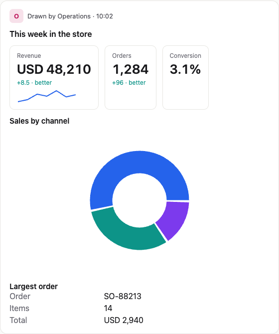 | 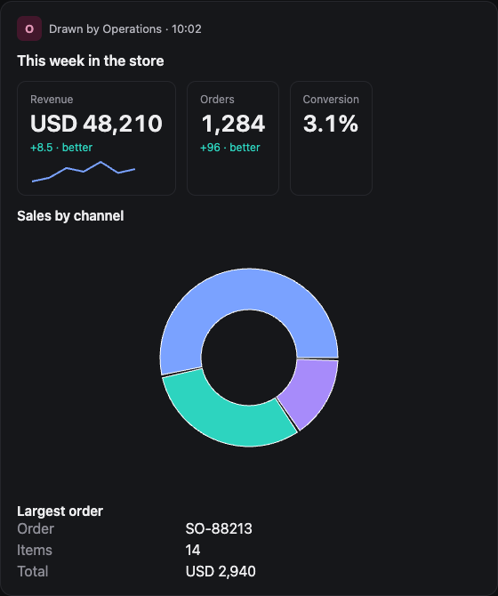 |
| **Incident command** (`incident-command`): metrics, a latency chart, a status badge, and **Start rollback** with a reason field, which asks first | 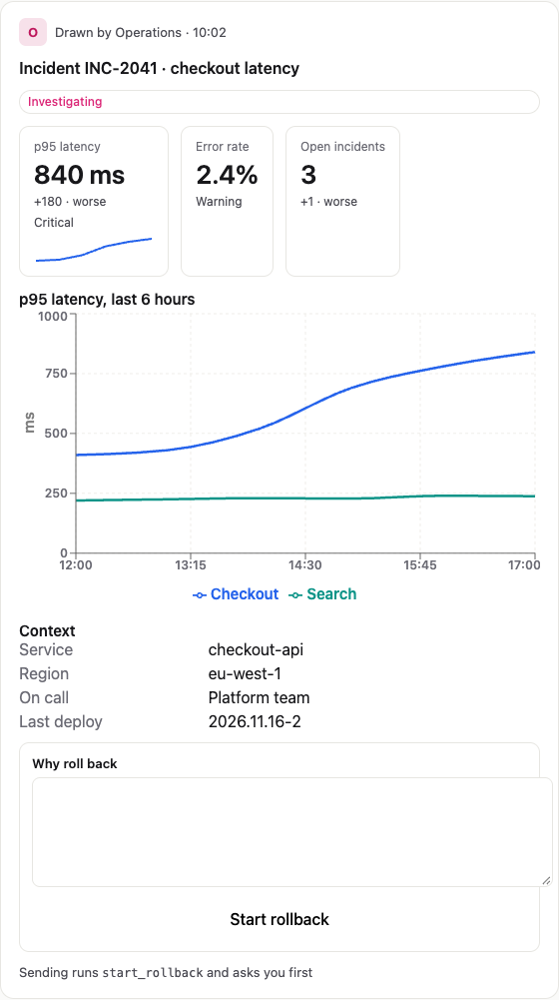 | 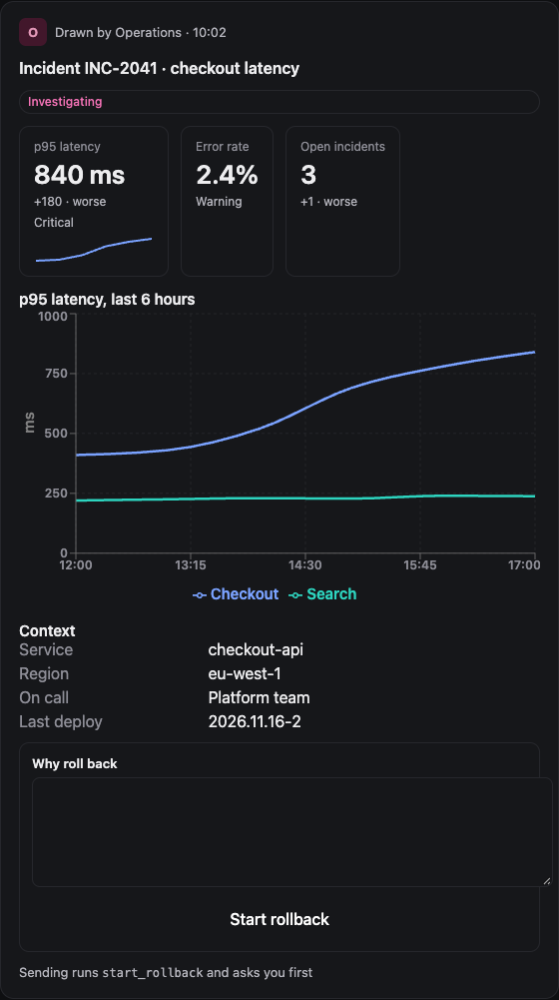 |
| **Live throughput** (`streaming-operations`): `Sparkline`s, `Metric`s and `Progress`, updated with `patch_surface` | 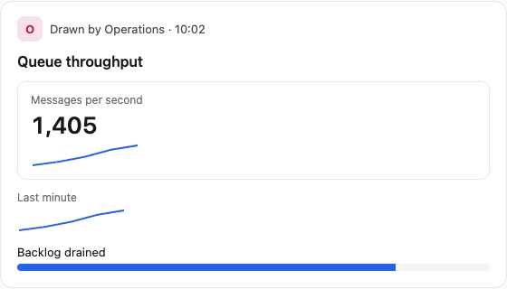 | 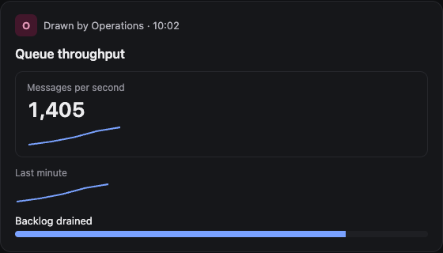 |
| **A support request** (`support-workflow`): a form whose **Send** asks the person first | 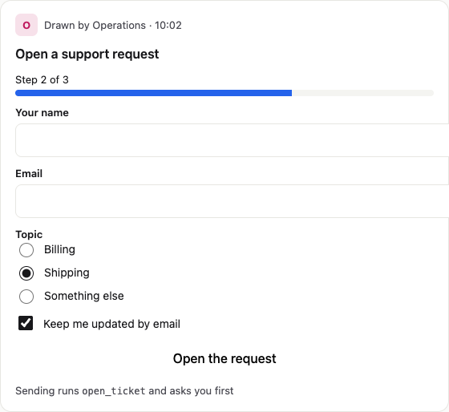 | 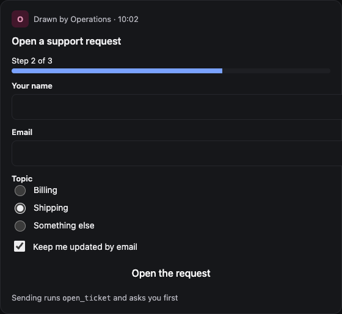 |

## studio

| Drawing | Light | Dark |
|---|---|---|
| **A release room** (`release-room`): an `App` of `Page`s (Overview, Checklist, Deploys) and `Region`s, with progress and badges | 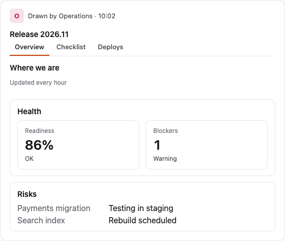 | 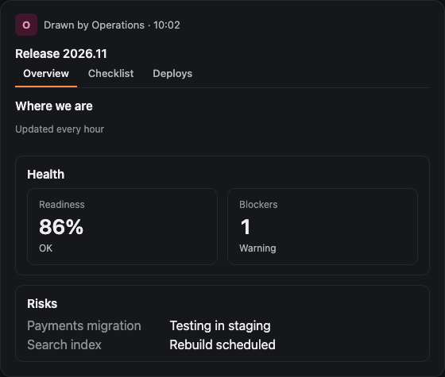 |
| **Loading bays** (`spatial-logistics`): studio's `Scene3D` of the docks and a truck, a Dock picker, and **Reserve this dock**, which asks first | 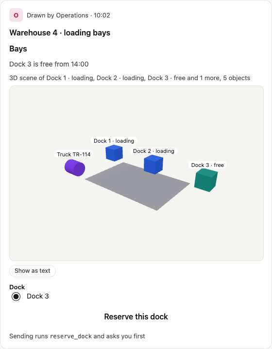 | 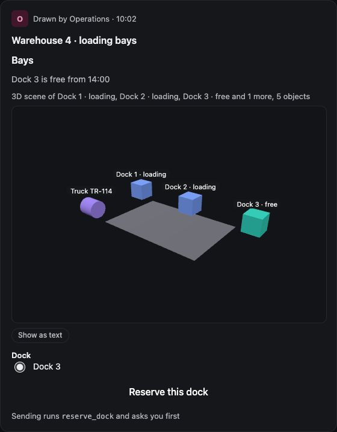 |

## spatial

| Drawing | Light | Dark |
|---|---|---|
| **Revenue by quarter and region** (`spatial-revenue-bars`): `Bar3D` in a `Stage` with `Metric`s | 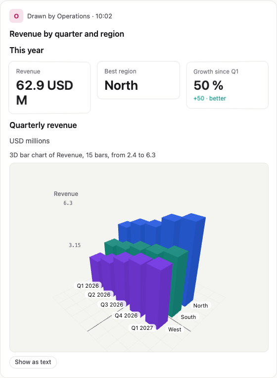 | 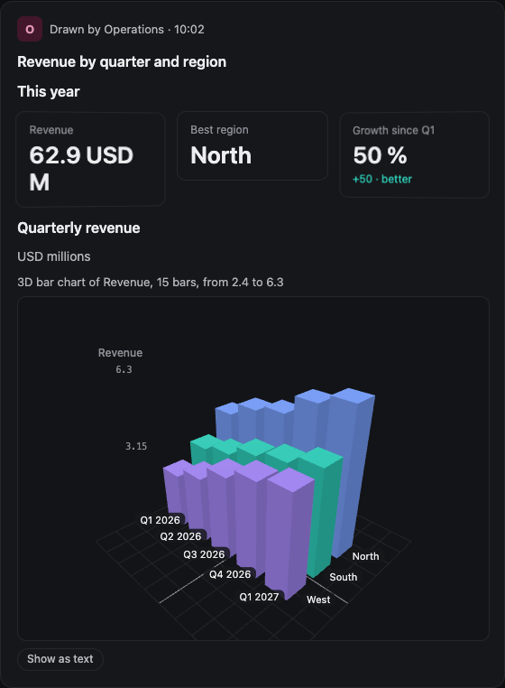 |
| **Shipments in flight** (`spatial-fleet-globe`): a `Globe` with places and routes | 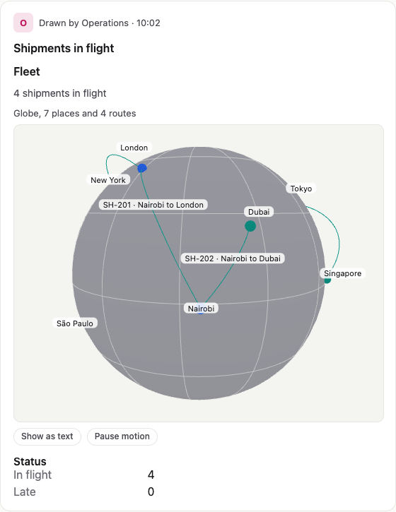 | 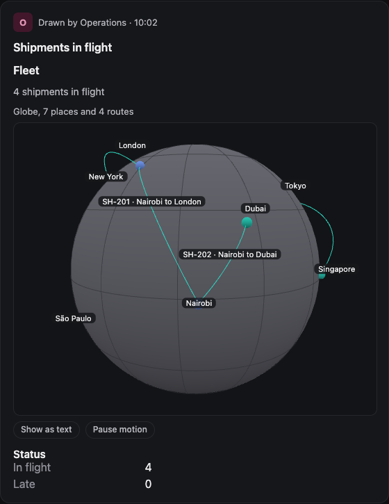 |
| **Checkout and its dependencies** (`spatial-service-graph`): a `Graph3D` beside a `DepthCard` that flips | 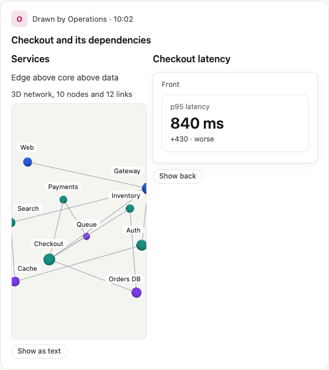 | 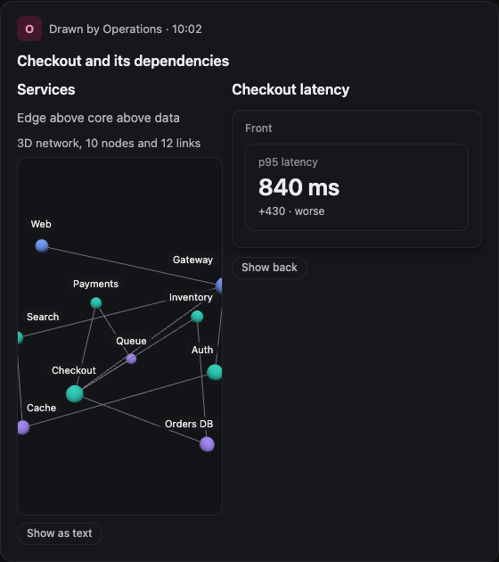 |
| **Field 7 · signal** (`spatial-terrain`): a `SurfacePlot` and a `Scatter3D` | 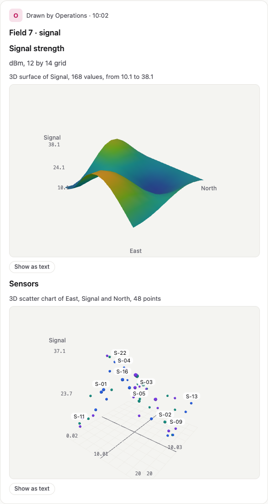 | 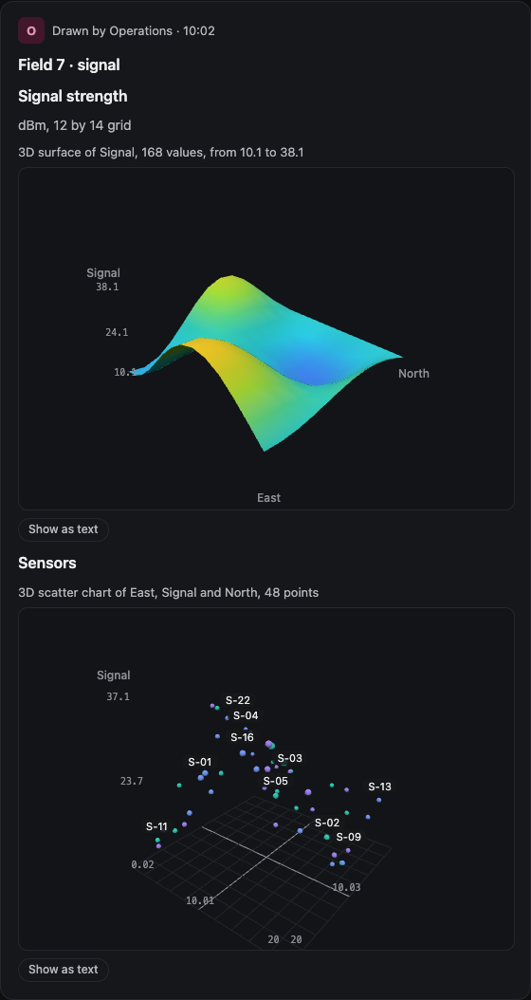 |
| **Yard B · docks** (`spatial-warehouse-pick`): a `Scene` with groups, motion and a panel; picking a dock fills the form's Dock field, and **Reserve this dock** asks first | 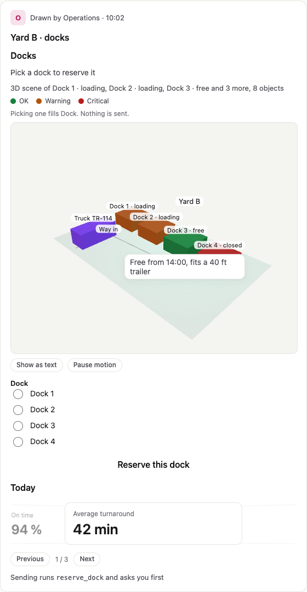 | 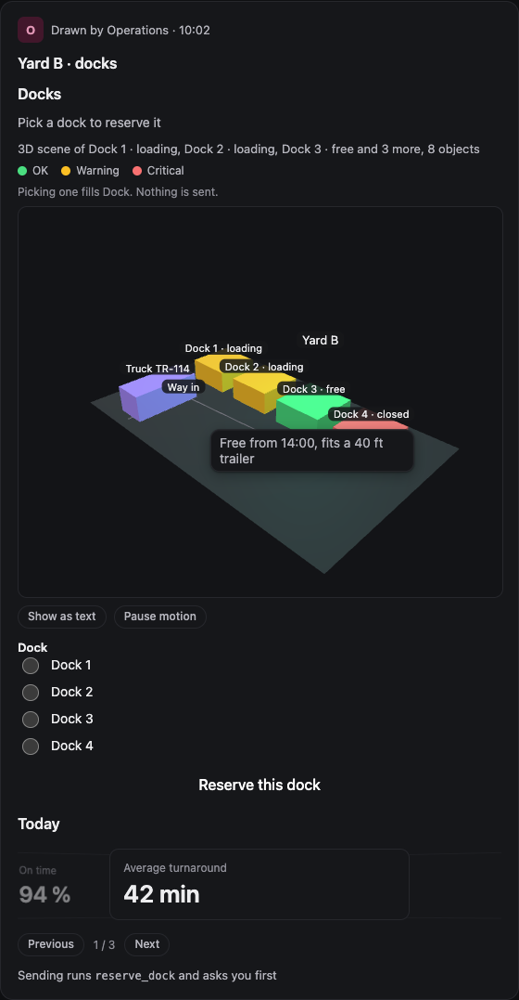 |

Every 3D drawing has **Show as text**, which is also what the terminal and a browser without
WebGL show. A scene's colours are palette names and states, never hex; its labels are page text;
and picking an object fills a choice field the drawing shows, never sending anything. See
[README § 3D](../README.md#3d).
